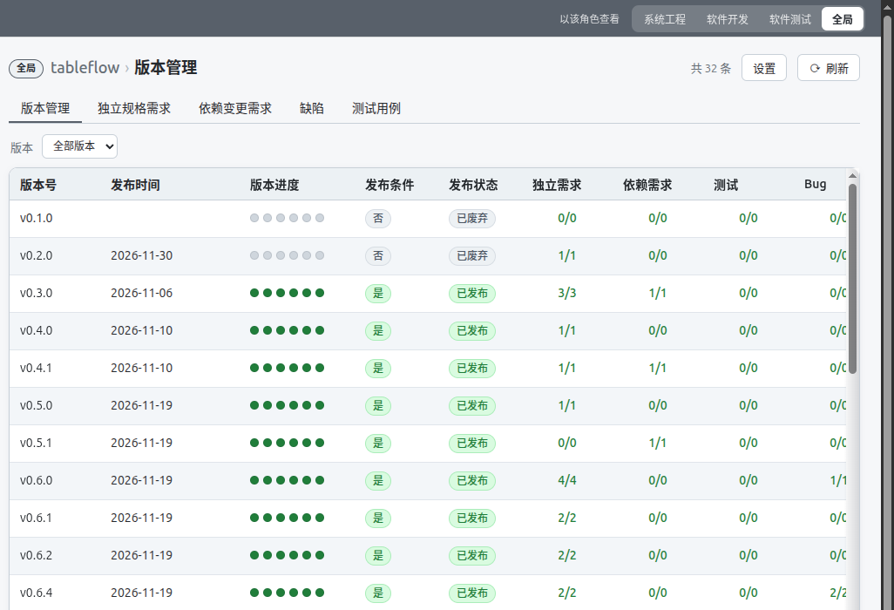
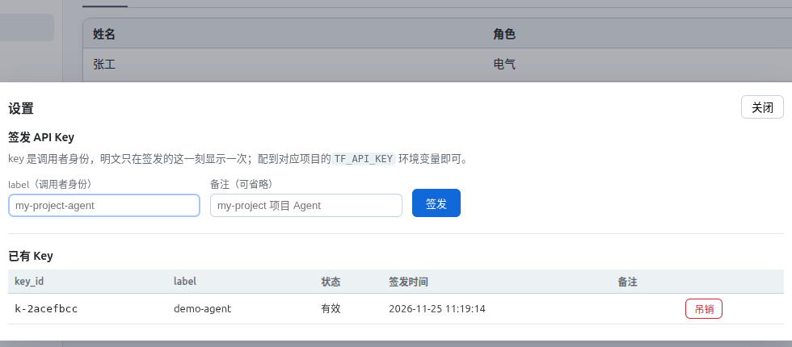
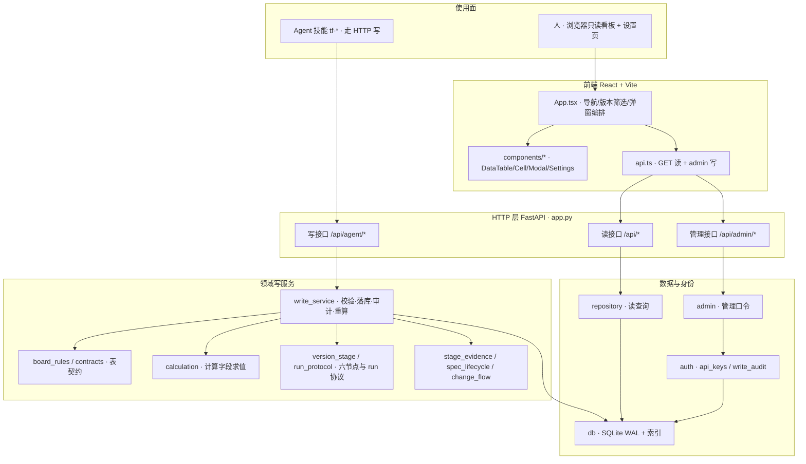

# TableFlow

**A self-hosted R&D governance board where humans read and AI agents write.**

TableFlow runs the delivery process as data instead of documents: one board holds
versions, specs, change orders, test cases, runs and defects; six serial gates
decide whether a version may ship; every write goes through a typed HTTP API,
carries a caller identity, and lands in an audit trail. FastAPI + SQLite (WAL) +
React. 448 backend tests, no external services, single container.

[架构](#架构) · [快速开始](#快速开始) · [看板契约](#看板契约board5) · [API](#agent-接口) · [技能](#agent-技能) · [贡献](CONTRIBUTING.md)

---

## 为什么做这个

Agent 已经能写代码、跑测试、改文档，但「谁在什么时候因为什么把版本推进了一格」通常散落在聊天记录、CI 日志和人的记忆里。TableFlow 把这条链路做成一块可核验的看板：

- **人只读**：界面没有编辑入口，人看到的就是库里的真相，不存在「界面显示完成、实际没做」。
- **Agent 写**：所有变更走 `/api/agent/*`，按 `X-API-Key` 识别调用者，字段级变化另记 `business_changes`。
- **闸门是算出来的**：版本能不能发不是人拍板，是六个节点、用例执行、缺陷清零、变更回归的布尔与运算结果。

## 特性

| | |
|---|---|
| 六表看板 | 版本 / 独立规格需求 / 依赖变更需求 / 测试用例 / 用例执行情况 / 缺陷 |
| 六节点闸门 | 版本需求设计 → 测试设计 → 开发 → 开发验收 → 测试 → 测试验收，串行推进、不可跳过 |
| 计算字段 | ratio / rollup / sum / and / percent，写侧求值、读侧只读；闸门字段禁止人工覆盖 |
| 可核验的写 | 每次写入落 `write_audit`（含 key 标识、来源、结果），字段值真实变化才记 `business_changes` |
| 一次性凭据 | API key 只存 SHA-256，明文仅签发时显示一次；吊销即时生效 |
| 设置页 | 口令进入，页内签发/吊销 key，不需 SSH 上机 |
| Agent 技能 | 10 个 `tf-*` 技能把「登记需求 / 开变更单 / 推进节点 / 派生用例 / 回写结果 / 判发布」封装成可调用动作 |

## 截图

版本看板：六节点合并为灯组，发布条件是算出来的。



设置页：口令解锁后签发 / 吊销 API key，明文只显示一次。



## 架构



写入只有一个入口：`/api/agent/*` 全部进 `write_service`，由它统一做鉴权、校验、写库、审计与下游计算重算，没有第二条写路径。依赖单向无环。

## 快速开始

Docker（推荐，单端口 8090）：

```bash
git clone https://github.com/logan0116/tableflow.git
cd tableflow
cat > deploy/.env <<'EOF'
TABLEFLOW_ADMIN_TOKEN=change-me-at-least-8-chars
EOF
bash deploy/deploy.sh          # 同步到 deploy/.env 里的 HOST 并用 compose 起容器
```

不想用脚本就直接起来：

```bash
docker build -t tableflow:1.0.0 .
docker run -d --name tableflow -p 8090:8090 \
  -v "$PWD/data:/data" \
  -e TABLEFLOW_DB=/data/tableflow.db \
  -e TABLEFLOW_STATIC_DIR=/app/frontend/dist \
  -e TABLEFLOW_AUTH_MODE=enforced \
  -e TABLEFLOW_ADMIN_TOKEN=change-me-at-least-8-chars \
  tableflow:1.0.0
```

首次启动后签发一把 Agent key（界面右上角「设置」藏着这条命令的替代品）：

```bash
docker exec -i tableflow python -c "
from pathlib import Path
from tableflow import auth
from tableflow.db import connect_write, init_schema
conn = connect_write(Path('/data/tableflow.db')); init_schema(conn)
record, raw = auth.issue_key(conn, 'my-agent', note='示例')
print(raw)
"
```

本地开发：

```bash
cd backend && uv sync && uv run uvicorn tableflow.app:app --reload --port 8000
cd frontend && npm install && npm run dev        # 代理到 8000
```

容器默认 `TABLEFLOW_AUTH_MODE=enforced`（写请求必须带 key）；本地默认 `legacy`（未带 key 时回退 `X-Agent-Id`），方便调试。

## 看板契约（board@5）

口径的唯一来源是 [`specs/019-test-contract/board@5.yaml`](specs/019-test-contract/board@5.yaml)：

| 表 | 一行代表什么 |
|---|---|
| `*-ver` | 一个发布版本；持有独立需求、变更单、缺陷与执行清单，六个节点串行推进 |
| `*-indep` | 一份规格；八类 speckit 阶段状态 + 验收状态 |
| `*-dep` | 一张变更单；已验收规格被改动时记录影响面与回归 |
| `*-case` | 一条测试用例；由 `spec.md` 的 Acceptance Scenario 派生 |
| `*-run` | 某个版本执行某条用例的结果（`<版本号>--<用例号>`，一次一条） |
| `*-bug` | 一个缺陷；`closed` 是唯一终态 |

发布条件 = `and(六节点全部 done)`；`发布状态` 的 `released` 会冻结该版本的范围、节点与状态。

## Agent 接口

| 方法 | 路径 | 说明 |
|---|---|---|
| GET | `/api/projects`、`/api/tables/{id}/table`、`/api/tables/{id}/rows/{row}` | 只读，无需鉴权 |
| POST/PATCH/DELETE | `/api/agent/projects`、`/tables`、`/fields`、`/rows`、`/recompute` | 写，需 `X-API-Key` |
| POST/PATCH | `/api/admin/unlock`、`/api/admin/keys`、`/api/admin/keys/{id}/revoke` | 设置页，需 `X-Admin-Token` |

写响应统一三态：`{"result":"success"}` / `{"result":"failed"}`（400，不重试）/ `{"result":"unknown"}`（503，**不得当成功**，须回读确认）。

## Agent 技能

`skills/` 下 10 个技能把流程封装成可调用的动作（Claude Code / DSH 等 Agent 可直接加载）：

| 技能 | 干什么 |
|---|---|
| `tf-register` | 按契约把一条需求分派到正确的表（新规格 / 变更单 / 就地改） |
| `tf-dev-plan` | 推进第 1 节点：校验版本范围与规格结构 |
| `tf-test-plan` | 推进第 2 节点：场景派生用例并纳入版本 |
| `tf-dev-implement` | 推进第 3 节点：plan → tasks → implement，跑单测 |
| `tf-dev-check` | 推进第 4 节点：实现+单测成立即验收 |
| `tf-test-implement` | 推进第 5 节点：回写执行结果与证据 |
| `tf-test-check` | 推进第 6 节点：复算用例/缺陷/回归三条闸门 |
| `tf-lifecycle` | 规格的 drop / split / cleanup |
| `tf-release-status` | 只读报告某版本能不能发，逐条给缺口 |
| `tableflow-board` | 底层 API 参考与建表配方 |

## 目录结构

```text
backend/    FastAPI + SQLite：只读 GET、/api/agent 写接口、/api/admin 设置页接口
frontend/   React + TypeScript + Vite
specs/      规格、契约与验收记录（001 起按需求编号分目录）
skills/     Agent 技能
data/       示例种子（* .db 不入库）
deploy/     部署脚本、compose、seed、容器入口
```

## 稳定性与版本

`v1.0.0` 起，board@5 契约与 `/api/agent`、`/api/admin` 接口按语义化版本演进：

- **MINOR** 只加字段与新接口，旧数据与旧调用继续可用；
- **MAJOR** 才改语义；同时提供 `backend/scripts/migrate_*.py` 迁移脚本与 [`CHANGELOG.md`](CHANGELOG.md) 升级说明；
- 数据库是单个 SQLite 文件，备份就是拷文件；`deploy/seed.sh` 用在线备份（`sqlite3.backup`）而不是直接复制。

## 安全

默认按「内网单机」部署设计：无内置账号体系、只读接口不鉴权、写接口靠 API key 识别身份。要放到不可信网络，先读 [`SECURITY.md`](SECURITY.md)：前面加反代与 TLS、把管理口令换成强口令、限制 `/api/admin` 来源。

## 贡献

见 [`CONTRIBUTING.md`](CONTRIBUTING.md)。跑一遍本地检查：

```bash
cd backend && uv run pytest -q
cd frontend && npm run build
```

## 许可证

[MIT](LICENSE)
